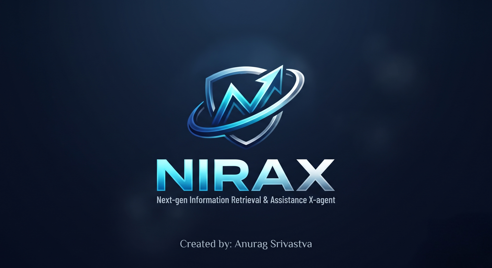

<p align="center">
  
</p>

<h1 align="center">✨ <b>N I R A X</b> ✨</h1>
<p align="center"><h3>🚀 <b>Next-gen Information Retrieval & Assistance X-agent</b> 🚀</h3></p>

<p align="center">
  <b><i>An Advanced Multimodal Desktop AI Assistant & Technical HUD</i></b><br>
  <sub><b>Created with Passion & Precision by Anurag Srivastava</b></sub>
</p>

<p align="center">
  
  
  
  
  
</p>

<p align="center">
  
</p>

---

---
## 🚀 Overview
**NIRAX** is an advanced, production-grade desktop AI assistant engineered from the ground up by **Anurag Srivastava**. It bridges natural language processing (Google Gemini LLM), system hardware telemetry diagnostics, custom voice-controlled execution, dynamic app/web launching, and real-time visual UI telemetry into a unified, high-performance desktop software suite.

---

## ✨ Core Features & Technical Capabilities

1. **🧠 Multi-Turn Chat Memory:** Built using Google's GenAI SDK chat sessions (`client.chats.create`), maintaining ongoing conversational context across back-to-back prompts.
2. **💻 Live System Diagnostics & Hardware Control:** Real-time monitoring of CPU load, RAM utilization, storage metrics, and battery status via `psutil`, alongside voice-activated Windows master volume controls (`pyautogui`).
3. **🎨 Designer Technical HUD & Theme Switcher:** Fully responsive, full-scale tactical interface featuring a dynamic sci-fi grid canvas and 5 instant theme palettes (*Cyber HUD Cyan, Matrix Green, Tactical Red, Synthwave Purple, and Solar Amber*).
4. **🔗 Custom App & Website Shortcut Manager:** Integrated JSON-backed shortcut mapper (`shortcuts.json`) allowing users to add and execute custom voice-activated web portals instantly.
5. **🎬 Cinematic Intro & Voiceover Sequence:** Fullscreen OpenCV video splash screen (`nirax_intro.mp4`) with synchronized text-to-speech welcome greetings.
6. **🎙 Interactive Voice Recognition:** Click-to-speak voice command deck utilizing Google Speech-to-Text and threaded `pyttsx3` text-to-speech synthesis.

---

## 🛠️ Tech Stack & Architecture
* **GUI & Interface:** Python `tkinter`, `ttk`, `Pillow (PIL)`, `tk.Canvas`
* **Artificial Intelligence:** Google GenAI SDK (`google-genai` using `gemini-2.5-flash`)
* **Voice & Audio Processing:** `speech_recognition`, `pyttsx3` (with thread locking)
* **System Automation:** `psutil`, `pyautogui`, `webbrowser`, `pywhatkit`, `subprocess`
* **Security & Distribution:** `python-dotenv`, `PyInstaller`, OpenCV (`cv2`)

---

## ⚙️ Installation & Setup Guide

### 1. Clone the Repository
```bash
git clone [https://github.com/YOUR_USERNAME/NIRAX-Virtual-Assistant.git](https://github.com/YOUR_USERNAME/NIRAX-Virtual-Assistant.git)
cd NIRAX-Virtual-Assistant

```
### 2. Install Required Python Dependencies
```bash
pip install google-genai python-dotenv speech_recognition pyttsx3 pywhatkit psutil pyautogui pillow opencv-python numpy

```

### 3. Configure Your Environment Variables
Create a file named .env in your root folder and add your Google AI Studio API key:
GEMINI_API_KEY=your_actual_gemini_api_key_here

### 4. Run NIRAX loaclly
python nirax.py

## 📦 Standalone Software Deployment (.exe)
To compile NIRAX into a standalone Windows desktop application executable bundle:
pyinstaller --onefile --noconsole --add-data ".env;." --add-data "nirax_logo.png;." --add-data "nirax_intro.mp4;." nirax.py

---
## 🔮 Future Scope & Roadmap

* **📱 Cross-Platform Mobile Application (Android/iOS):** Transitioning the architecture to support mobile environments using the **Kivy** framework, providing touch-optimized mobile HUD layouts.
* **☁️ Cloud Synchronization (`Firebase`):** Real-time synchronization of custom user shortcuts (`shortcuts.json`) and session preferences across multiple client devices.
* **🎙 Native Mobile Voice Wrappers (`Plyer`):** Integrating native speech-to-text plugins to enable touch-to-talk voice commands seamlessly on mobile handsets.
* **📧 Advanced Email & Calendar Sync:** Expanding productivity commands to allow NIRAX to securely read unread emails and parse local calendar events directly by voice.
---


### 👤 Creator
Anurag Srivastava
